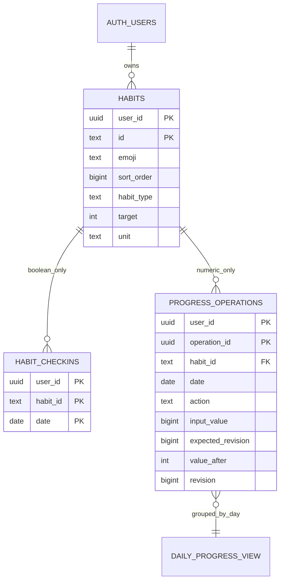

# 数据库审计和推荐模型

## 现状（代码/迁移审计，非远程数据库现场审计）

`src/domain.ts` 的 Habit 为字符串 id、name、color、created_date、archived_on；Checkin 为 habit_id/date。parseSnapshot 忽略额外字段，全部现有统计只认识行存在即完成。`src/cloud.ts` 调用 habit_mobile 的五个 RPC。数据日期在前后端均固定 Asia/Shanghai；归档当天含在有效历史，归档后不能再打卡/撤销；未来/创建前日期不可写。Supabase 会话、7/30 天规则与认证键隔离不在本轮变更范围。

`202610110001_mobile_cloud.sql`：

| 对象 | 约束/权限 |
|---|---|
| habits | PK(user_id,id)，id text；user_id 默认 auth.uid()，FK auth.users；名称/颜色检查；日期/身份触发器不可修改；无客户端 DELETE |
| habit_checkins | PK(user_id,habit_id,date)，复合 FK habits；仅 INSERT(habit_id,date)/DELETE，无 UPDATE |
| 五个 RPC | create_habit、edit_habit、archive_habit、set_checkin、read_snapshot；SECURITY INVOKER、空 search_path、auth.uid() 校验 |
| 两个触发器 | guard_habit / guard_checkin；所有者、日期、归档检查；父习惯行锁 |
| RLS | 两表 ENABLE/FORCE，authenticated 仅自己记录，anon 无表或 RPC 权限 |
| 历史读取 | read_snapshot 单条 SQL 的一致快照，返回全部记录，未限当月；每次读取的数据量随历史线性增长 |

旧 001/002 是不同 schema 的复杂同步方案，不是本轮基础，也不能作为安装前置。真实项目的对象/所有者/授权是否和源代码相同，必须由用户执行只读检查确认。

## 哪些功能需要扩展

| 功能 | 现有数据是否足够 |
|---|---|
| Boolean 年度热力图、周月完成率/趋势 | 足够，需统一有效日期与无数据规则 |
| 7/21/30 天派生徽章 | 足够计算历史成就；不够记录删除证据后仍不可撤销的解锁事件 |
| Emoji | 不够，增加 emoji 独立列 |
| 跨设备排序 | 不够，增加 sort_order 与原子批量 RPC |
| 学习分钟/次数、修正与重试 | 不够，需不可变数值命令及每日最新状态 |

## 方案比较

| 方案 | 优点 | 成本/风险 | 决策 |
|---|---|---|---|
| A. 扩展 habit_checkins 为 value 行 | 少一张进度表 | 行存在不再等于完成，旧客户端会把部分进度当完成；旧 DELETE 可删除数值历史；仍需幂等回执 | 不选 |
| B. 每日进度实体表 + 独立回执表 | 每日一行，读取直观 | 数值状态与回执需要维护两份一致性，增加两张表；必须事务更新 | 备选 |
| C. 保留 Boolean 表，数值操作日志兼作不可变回执，视图取每日最后版本 | 原表历史不改；只有一个数值真源；并发/重试/审计同一条 INSERT；无额外角色或 definer | 日志比每日表大，不能随意清理；需新客户端/API | **推荐** |

日志是受范围限制的业务数值命令，不是设备同步日志：没有同步游标、订阅、离线队列、冲突合并框架或设备注册。

DAILY_PROGRESS_VIEW 是 security_invoker 视图，不存第二份数据。

## 字段、边界与历史

habits 新列：

- emoji text NOT NULL DEFAULT 🌱；允许 🌱 📚 💧 🏃 🌙 🎨 🧘 🍎 🧹 ✨。精确 Unicode 白名单避开“字符串长度=可见字符数”的错误；拒绝组合变体、肤色/性别组合、空串、控制符、非法文本及 HTML，不静默截断。客户端只能发送面板值；将来扩展白名单需迁移。
- sort_order bigint NOT NULL DEFAULT 0，0..10^12。旧行全部为 0，按 sort_order,created_at,id 稳定排序，旧顺序不变；不回写归档行、不改创建时间。新增在所有旧 rank 的 max+1024 末尾；批量重排只改活跃行，归档 rank 保留。重复 rank 合法，有确定性 tie-break；没有容易中途冲突的 UNIQUE(rank)。
- habit_type：boolean/duration/count；target 整数；unit 受类型联合 CHECK 约束。Boolean 固定 1/completion，Duration 1..1440/minute，Count 1..1000000/repetition。实际量可超过目标，但不超过类型上限，UI 进度最多 100%，实际值不截断。
- 类型、目标、单位创建后固定。否则没有进度行的历史日期也会受目标变更影响，仅给已有行保存 target 快照还不足以还原所有计划。第一版通过归档+新习惯明确变更，不增加目标历史表；后续需要编辑目标再设计按生效日期的目标历史。若当天归档并新建，两项按现有规则都计入当天分母；建议次日创建替代，或明确接受这是两项独立任务，不宣称无缝更改同一习惯目标。

progress_operations：PK(user_id,operation_id)，UNIQUE(user_id,habit_id,date,revision)，复合 FK habits。command 输入仅 operation_id/habit_id/date/action/input_value/expected_revision；value_after/revision/created_at 全由触发器产生，客户端不能提交或修改，表无 UPDATE/DELETE。某日没有命令视为实际 0/版本 0；set 0 仍保留修正事件。

habit_daily_progress 取每组最大 revision。Boolean 完成只读 habit_checkins；Duration/Count 完成只读此视图的 actual_value>=habit.target。两个写入口互相拒绝错误模式，因此不存在同一习惯同时有两种完成真源。

## 原子性、幂等与并发

- 所有新写 RPC 和触发器使用 auth.uid()，先取得每用户事务 advisory lock，再锁所需习惯；不使用客户端 user_id。哈希碰撞最多导致额外等待，不影响身份隔离。锁只是串行化工具，RLS/显式 owner 条件才是权限边界。
- add：正整数增量，在锁内取最新值后累加；两个设备 +5 和 +15 最终 +20。set：非负整数修正，必须给当前 expected_revision；过期时 40001/revision_conflict，回读后让用户确认，不能静默覆盖。
- 同 operation_id+同负载返回最初回执，不再累计；相同 ID 不同负载报 operation_id_reused。两个账号可独立使用相同 UUID。原回执可能早于后续操作，因此 **重试回执不是最新快照**，客户端必须比较 revision 或回读，不能把旧回执覆盖到新状态。
- 数值命令、计算结果、操作回执就是同一不可变行，事务异常全部回滚；没有双写不同步窗口。直接 INSERT 受同一触发器规则及列权限限制，不能伪造回执。
- 排序使用当前完整活跃 ID 列表作为 expected，验证无重复、全属当前账号、恰好覆盖活跃集合；最多 500 项。一次 UPDATE 原子提交。新增/归档/别人改顺序会使旧 expected 冲突；同目标已在服务器可安全返回 unchanged。它是“值 CAS”，不是事件版本，不保证检测 A→B→A 的 ABA；最终值相同的 ABA 不造成排序覆盖不同当前值。
- 保留旧客户端所需 habits UPDATE，故原始表接口仍能改自己合法的 name/color/emoji/rank；RLS 不能代替业务协议。新客户端只使用排序 RPC 来获得整组 CAS/原子保证，原始独立 rank 修改不具有此承诺。排序重复值仍稳定可读。
- SQL 直连客户端若自行倒置锁顺序（先 raw UPDATE、后 RPC）可能触发死锁，数据库会回滚其中一笔；正式 API 事务统一先按账号锁定。40001/40P01 都应先回读，不盲目重复数值增量。

## 安全权限

全部函数 SECURITY INVOKER、search_path=''，表 RLS/FORCE RLS；视图 security_invoker=true（要求 PG15+）。无新角色、ALTER OWNER、Auth GRANT OPTION、SECURITY DEFINER 或服务端密钥。

authenticated 仅增加 habits 的 INSERT(emoji,habit_type,target,unit)、UPDATE(emoji,sort_order)；日志 SELECT 和输入列 INSERT；视图 SELECT；八个新业务 RPC 及内部 require_user_v3 的 EXECUTE。内部 helper 仅校验自己身份/取自己锁，无跨用户参数；无需作为 Data API 函数暴露。三个 guard 触发器函数不开放客户端 EXECUTE。anon/PUBLIC 无新对象权限。

默认原表权限/RLS 不放宽到其他用户。触发器再次检查归属/模式/日期/归档。SQL 注入无动态用户 SQL；标识按 text 参数使用，所有对象完整限定 schema。真实 JWT 签名验证仍由 Supabase Auth/PostgREST 完成，模拟 claim 不能验证这层。

### 排序字段候选比较

整数/Bigint 连续 rank 易于用一次 RPC 重排，个人习惯通常几十项，更新成本可控；本草案选有界 bigint。浮点/分数 rank 能少改行，但会出现精度/间隙耗尽与重归一化问题。链表前后指针会引入断链/环与并发修复，本项目不采用。排序是用户自己的全局活跃列表，不引入分类局部排序或设备专属顺序。

Duration 第一版是用户明确提交的整数分钟累计，不是后台运行的计时器；不会把页面关闭期间的时间自动记入云端。未来若增加运行中计时器，需另审开始/暂停/结束和休眠边界，不把它混入本次数据库审批。
